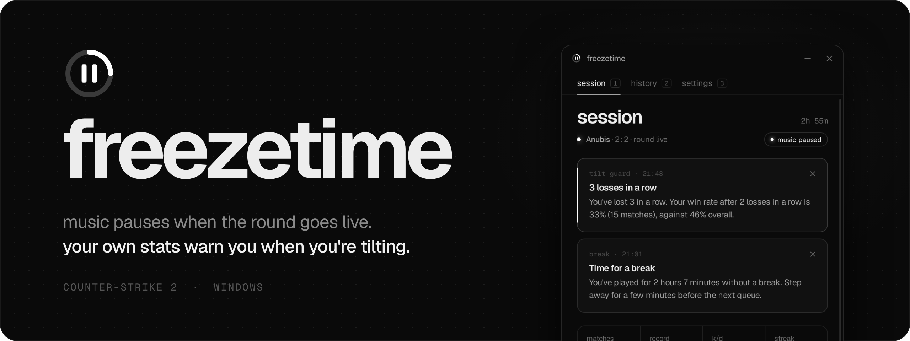
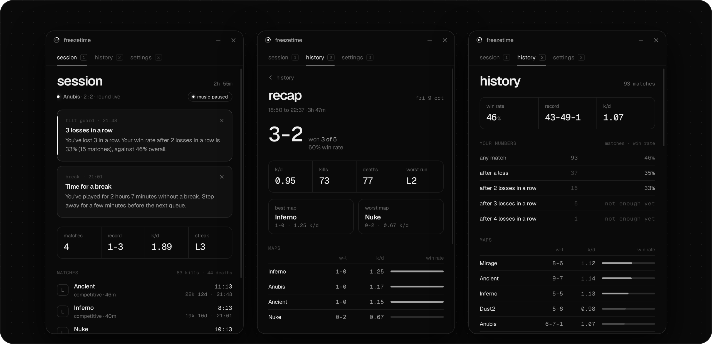

<p align="center">
  
</p>

<p align="center">
  <a href="https://github.com/Kh8da/freezetime/releases/latest"><b>Download</b></a>
  &nbsp;·&nbsp;
  <a href="#how-it-works">How it works</a>
  &nbsp;·&nbsp;
  <a href="#faq">FAQ</a>
  &nbsp;·&nbsp;
  <a href="#build">Build</a>
</p>

<br>

You queue with music on. The round goes live and you're still hearing the chorus over the footsteps. You lose
three in a row and queue a fourth anyway, because it feels like the next one will turn it around.

**freezetime** sits in the tray while you play CS2. It pauses your music when a round goes live and plays it again
when you die or the round ends. When you're on a losing streak it tells you how you've done after streaks like
this before, with your own numbers. It reminds you to take a break, but only between matches, and when you stop
it shows you how the session went.

It uses CS2's official Game State Integration, the same feed tournament overlays and RGB lighting apps use. It
never touches the game.

## Download

| Platform | File | |
|---|---|---|
| Windows 10 / 11 | [`freezetime-windows-x64.exe`](https://github.com/Kh8da/freezetime/releases/latest/download/freezetime-windows-x64.exe) | Single file, nothing to install |

The exe isn't code-signed, so Windows asks once on first launch:

<details>
<summary><b>"Windows protected your PC"</b></summary>
<br>
Click <b>More info</b>, then <b>Run anyway</b>. Windows remembers the choice.
</details>

### Setup

1. Open freezetime and click **add the file**. It finds CS2 through Steam and puts one small file in the game's
   cfg folder.
2. Start CS2, or restart it if it's open. The game reads the file at launch.

The dot next to "waiting for cs2" turns white when the first update arrives. That's it.

## Features

<p align="center">
  
</p>

- **Music pauses during rounds.** Whatever is playing pauses when the round goes live and comes back when you die,
  when the round ends, at halftime and between matches. Spotify, browsers, foobar2000, anything that shows up in
  Windows' media flyout. No account, no API key. Only what was playing gets resumed; if you paused something
  yourself, it stays paused.
- **Tilt guard.** After the match that puts you on a losing streak (3 by default), you get a notification like
  *"You've lost 3 in a row. Your win rate after 3 losses in a row is 38% (13 matches), against 52% overall."*
  The numbers come from your own history, and it says so when there isn't enough of it yet.
- **Break reminders, between matches only.** After 90 minutes of play (or whatever you pick), the reminder comes
  when a match ends. Never mid-round. Fifteen minutes out of matches counts as a break and resets the clock.
- **Session recap.** When you close CS2 or end the session: matches, record, K/D, kills and deaths, your worst
  losing run, and your best and worst maps.
- **History.** Every Premier and Competitive match you finish, your win rate per map, and how you play after one,
  two, three or four losses in a row.
- **Small and quiet.** One exe, no installer. It does nothing at all until CS2 sends something, and nothing leaves
  your PC.

Only Premier and Competitive count toward your numbers. Music control works in every mode.

## How it works

CS2 has a documented feature called Game State Integration. Put a `gamestate_integration_*.cfg` file in the game's
cfg folder and CS2 sends match updates to the address inside it, as JSON over HTTP. freezetime's file looks like
this:

```
"freezetime"
{
	"uri"		"http://127.0.0.1:38127/"
	"auth"
	{
		"token"	"<random, made on first run>"
	}
	"data"
	{
		"provider"		"1"
		"map"			"1"
		"round"			"1"
		"player_id"		"1"
		"player_state"		"1"
		"player_match_stats"	"1"
	}
}
```

From those updates freezetime knows the map, the score, the round phase, whether you're alive and your
scoreboard line. Nothing about other players' positions, the bomb or grenades is requested.

| In the game | Music |
|---|---|
| Menu, warmup, freeze time | plays |
| Round live, you're alive | paused |
| You die | plays |
| Round over, halftime, match over | plays |
| CS2 closed or crashed | plays |

### Careful by design

- **It never touches CS2.** No reading or writing game memory, no injecting, no hooks, no looking at the process.
  The only thing it writes in the game's folder is its own cfg file, and **remove file** in settings takes it out
  again. Nothing here is different from what tournament overlays and Discord or RGB integrations do.
- **Only your PC can talk to it.** It listens on `127.0.0.1` only, so nothing on your network can reach it. Every
  update has to carry the token from the cfg file. Requests from web pages are refused outright, so a site you
  have open can't feed it fake matches.
- **No network, no telemetry.** It makes no connections of its own. Your history stays in a file on your PC.
- **Two small registry entries, both for your user only.** One lets Windows show its notifications under its own
  name (`HKCU\Software\Classes\AppUserModelId\app.freezetime`). The other is "Start with Windows", only if you
  turn it on.

## FAQ

<details>
<summary><b>Can this get me VAC banned?</b></summary>
<br>
No. Game State Integration is a feature Valve built into CS2 for exactly this, and freezetime only uses that. It
never opens the game's process or memory and never changes game files. The cfg file it adds is the documented way
to turn the feed on. freezetime isn't made or endorsed by Valve, though.
</details>

<details>
<summary><b>The notifications don't show while I'm playing.</b></summary>
<br>
Windows holds back notifications while a game runs fullscreen. To let freezetime's through, add it in Windows
Settings → System → Notifications → Set priority notifications → Add apps. Either way, the latest warning and
reminder wait for you in the app.
</details>

<details>
<summary><b>Music didn't pause.</b></summary>
<br>
Check that the player shows up in Windows' media flyout (the one that appears when you press a media key or
change the volume). freezetime uses the same controls, so a player that isn't there can't be paused. Also check
that the dot in freezetime is white: if it isn't, CS2 isn't sending updates yet, usually because it was already
running when the file was added.
</details>

<details>
<summary><b>It says "Restart CS2".</b></summary>
<br>
CS2 is sending updates with an older token, because the file changed after the game started. CS2 only reads the
file at launch, so close it and open it again.
</details>

<details>
<summary><b>Why does it keep running when I close the window?</b></summary>
<br>
So it's there when the round goes live. Closing the window hides it to the tray; quit from the tray icon or from
settings. It uses next to no CPU while it waits.
</details>

<details>
<summary><b>Where is my data, and how do I remove everything?</b></summary>
<br>
History and settings are in <code>%APPDATA%\app.freezetime</code>. To remove freezetime completely: click
<b>remove file</b> in settings, quit, delete the exe and that folder, and optionally the registry key above.
</details>

<details>
<summary><b>Wingman, Casual, Deathmatch?</b></summary>
<br>
Music control works in every mode. Results only count toward your numbers in Premier and Competitive, where a
win or a loss means the same thing every time.
</details>

## Build

You need [Rust](https://rustup.rs) and [Node.js](https://nodejs.org) 20 or later.

```sh
npm install
npx tauri build --no-bundle  # a single freezetime.exe in target/release
```

Every push runs [`build.yml`](.github/workflows/build.yml): the tests on Linux and Windows, and a Windows build
whose exe is attached to the run. Pushing a tag like `v0.1.0` publishes a release.

### Tests

```sh
cargo test -p engine                                           # tracker, rules, stats, listener
cargo build --release -p harness && ./target/release/harness   # end to end, fake CS2
```

The unit tests play whole matches built from payloads shaped like the ones CS2 sends: deaths where the feed
switches to the teammate you spectate, halftime side swaps, reconnects, draws, the Esc menu mid-round. `harness`
installs the cfg into a throwaway Steam library, starts the real listener, and runs `fake-cs2`, which reads that cfg
the way the game does and posts a whole session to it. It checks every pause and resume, the tilt warning, what
lands in the history file, that a wrong token is refused and that the listener can't be reached from the network.

### Layout

```
engine/      The core: GSI model, match tracker, music and reminder rules, stats, the listener
src-tauri/   The app shell: Windows media controls, notifications, tray, settings
ui/          The interface: plain HTML, CSS and JavaScript
harness/     End-to-end test, fake-cs2, and seed (fills a history for trying the UI)
```

Built with [Tauri](https://tauri.app). Set in [Geist](https://vercel.com/font).

## License

[MIT](LICENSE). The Geist font is under the [SIL Open Font License](ui/fonts/OFL.txt).

Not affiliated with Valve. Counter-Strike and Steam are trademarks of Valve Corporation.
